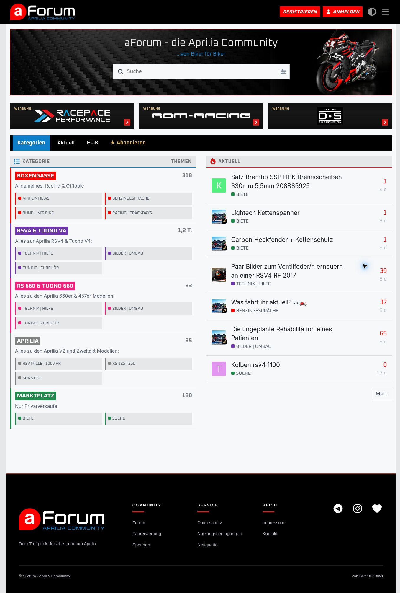

<div align="center">

# aForum Theme

### Motorsport im Auftritt. Forum im Mittelpunkt.

**Das Discourse-Haupttheme für die Aprilia-Community.**


[**Live ansehen →**](https://aforum.net) · [Installation](#installation) · [Einstellungen](#einstellungen) · [Änderungen](CHANGELOG.md)

</div>

---



*Die öffentliche Startseite von [aForum.net](https://aforum.net), aufgenommen am 30. Oktober 2026 im hellen Modus. Die Gastansicht zeigt nur öffentlich zugängliche Kategorien und keine Schaltfläche zum Erstellen neuer Themen. Banner, Sponsoren und weitere Seitenelemente stammen teilweise aus separat eingerichteten Komponenten.*

## Gebaut für eine Community mit Charakter

aForum verbindet eine klassische Forenübersicht mit einer klaren Motorsport-Optik: Schwarz als Rahmen, Blau für Orientierung und Rot für Aktionen. Kantige Unterkategorie-Kacheln führen direkt in die passenden Bereiche; gut lesbare Themenlisten rücken die Diskussionen in den Mittelpunkt.

**Beta 1.1 folgt dem KISS-Prinzip:** eine abgestimmte Gestaltung und wenige Einstellungen mit sichtbarem Nutzen.

## Was das Theme ausmacht

| Bereich | Gestaltung |
| --- | --- |
| **Startseite** | Kategorien links, aktuelle Themen rechts – mit klaren Bereichsüberschriften und farbigen Linien. |
| **Unterkategorien** | Flexible Kacheln mit Kategorienfarbe, Hover- und Fokuszuständen; auf schmalen Ansichten einspaltig. |
| **Typografie** | Inter für Beiträge, Thementitel und Beschreibungen. Die in Discourse gewählte Basisschrift bleibt für Navigation und Kategorien erhalten; aForum verwendet dort Oxanium. |
| **Navigation** | Gestaltbare Hintergrundfläche, blauer aktiver Tab und ein bündiger, eckiger „Neues Thema“-Button auf Desktop. |
| **Themenlisten** | Dezenter Flächenwechsel und ein roter, 3 px breiter Hover-Streifen links – ohne umlaufenden Rahmen. |
| **Diskussionen** | Kräftigere Bedienelemente und Zeitleisten-Beschriftungen im hellen Modus; gerader Antworten-Button. |
| **Hell & Dunkel** | Zwei mitgelieferte Farbpaletten und getrennte Farboptionen für beide Modi. |
| **Feinabstimmung** | Forenbreite, Schatten, Header- und Leistenhöhe sowie ein gemeinsamer Avatar-Eckenradius. |

### Desktop, Querformat, Hochformat

- **Desktop:** Kategorien und „Aktuell“ nebeneinander, standardmäßig zwei Unterkategorie-Spalten.
- **Smartphone quer:** einspaltige Unterkategorie-Kacheln innerhalb der Kategorienseite und ein kompakter Symbol-Button für neue Themen.
- **Mobile Kategorienansicht hochkant:** Hauptkategorie → aktuelle Themen → Unterkategorie-Kacheln. Die Themen bleiben vor der Navigation zu den Unterkategorien.

Die mobile Kategorienansicht verwendet eigenes Discourse-Markup. Die Darstellung hängt deshalb auch vom gewählten Kategorien-Seitenstil und den aktiven Komponenten ab.

## Installation

1. In der Discourse-Administration **Darstellung / Erscheinungsbild → Themes & Komponenten** öffnen.
2. **Installieren → Aus einem Git-Repository** wählen.
3. Diese Repository-URL eintragen:

   ```text
   https://github.com/ff4f-git/aForum-Theme
   ```

4. **aForum Beta 1.1** als Haupttheme aktivieren und die gewünschten hellen und dunklen Farbpaletten zuweisen.
5. Für die gezeigte Desktop-Startseite den Kategorien-Seitenstil **Kategorien und aktuelle Themen** auswählen.
6. Für den aForum-Schriftmix **Oxanium** als Discourse-Basisschrift einstellen. Inter wird vom Theme über Google Fonts geladen.
7. Gewünschte zusätzliche Komponenten zuweisen und die Darstellung auf Desktop und Smartphone prüfen.

> Das Repository ist ein **Haupttheme**, keine Theme-Komponente. Ein exaktes Abbild der Live-Seite erfordert zusätzlich deren Banner, Logos, Inhalte, Farbpaletten und Komponenten.

### Ein installiertes Theme aktualisieren

In der Discourse-Administration das installierte Git-Theme öffnen und aktualisieren. Danach die Seite neu laden und Startseite, Themenlisten und einen geöffneten Thread in beiden Farbmodi prüfen.

Beim Wechsel von älteren Alpha-Versionen wurden viele Detailoptionen entfernt. Individuelle Werte dieser entfernten Optionen werden nicht automatisch übernommen; bei Bedarf vor dem Update sichern. Der lokal vergebene Theme-Anzeigename kann nach einem Update bestehen bleiben.

## Einstellungen

Alle aktuellen Optionen stehen in [`settings.yml`](settings.yml). Zahlenwerte besitzen feste Wertebereiche; ob Discourse sie als Zahlenfeld oder grafischen Regler darstellt, hängt von der Admin-Oberfläche ab.

### Übersicht & Navigation

| Einstellung | Standard | Wirkung |
| --- | --- | --- |
| `max_width` | `1320` px | Maximale Desktop-Forenbreite; 900–2000 px. |
| `compact_lists` | An | Kompaktere Kategorietabelle; Beschreibungen auf zwei Zeilen begrenzt. |
| `subcategory_tiles` | An | Unterkategorien als Kacheln statt kompakter Textlinks. |
| `subcategory_columns` | `2` | 1–3 Unterkategorie-Spalten; mobile Regeln wechseln auf eine Spalte. |
| `lock_parent_category_links` | An | Deaktiviert Mausklicks auf die Hauptkategorie-Titel der Kategorien-Startansicht. |
| `nav_background_enabled` | An | Zeigt die Hintergrundfläche der horizontalen Navigation. |
| `bar_height` | `52` px | Höhe der Navigationsleiste; 36–80 px. |

**Überkategorie-Sperre:** Die Umsetzung ist bewusst rein CSS-basiert. Unterkategorie-Links bleiben bedienbar; Tastaturaktivierung und direkte Kategorie-URLs bleiben möglich. Die Einstellung verändert keine Discourse-Berechtigungen.

### Proportionen & Schatten

| Einstellung | Standard | Wirkung |
| --- | --- | --- |
| `panel_shadow` | An | Schatten um die Forenfläche. |
| `shadow_opacity` | `18` % | Schattenstärke; 0–60 %. |
| `header_height` | `80` px | Desktop-Kopfzeile; 56–140 px. Mobil bleibt sie bei 56 px. |
| `avatar_radius` | `3` px | Gemeinsamer Avatar-Eckenradius; 0–50 px. 0 = eckig, große Werte runden übliche Avatargrößen ab. |

### Farben

HEX-Farbwerte mit `#` eingeben, beispielsweise `#0F7EC9`. Hell und Dunkel lassen sich getrennt einstellen.

| Einstellung | Standard | Wirkung |
| --- | --- | --- |
| `color_accent_light` / `color_accent_dark` | Leer | Allgemeine Theme-Akzente; leer übernimmt `quaternary` aus der jeweiligen Palette. |
| `color_nav_light` / `color_nav_dark` | Leer | Hintergrund der Navigationsleiste; leer übernimmt `header_background`. |
| `banner_subtitle_color_light` / `banner_subtitle_color_dark` | `#0f7ec9` | Untertitel des separat eingerichteten Willkommensbanners. |

**Welche Farbe kommt woher?**

| Element | Farbquelle |
| --- | --- |
| Aktiver Tab „Kategorien“, „Aktuell“ usw. | `tertiary` der Discourse-Farbpalette |
| „Neues Thema“-Button | `quaternary` der Discourse-Farbpalette |
| Allgemeine primäre Buttons und bestimmte Zähler | Theme-Akzentfarbe, ersatzweise `quaternary` |
| Navigationshintergrund | Theme-Navigationsfarbe, ersatzweise `header_background` |
| Kategorien und ihre farbigen Markierungen | Discourse-Kategorieeinstellungen |
| Linker Hover-Streifen der Themenlisten | Festes `#FF0000`, 3 px |
| Markenblaue Bereichsakzente | Festes `#0F7EC9` |

Damit lassen sich die schwarze Leiste, der blaue aktive Tab und der rote „Neues Thema“-Button unabhängig voneinander zuordnen. Die Akzentfelder überschreiben nicht automatisch die Farbe dieses Buttons.

## Was separat eingerichtet wird

Der Screenshot zeigt das Zusammenspiel des Hauptthemes mit der aForum-Installation. Diese Bestandteile werden außerhalb dieses Repositories verwaltet:

| Bestandteil | Einrichtung |
| --- | --- |
| Willkommensbanner mit Suche und Motorradmotiv | Separate Banner-Komponente und deren Inhalte |
| Sponsor-Kacheln | **aForum Premium Sponsors** |
| Zusätzliche Badge-Gestaltung | **Category Badge Styles EVO**, sofern verwendet |
| Mobile Startseitensteuerung | **Force Mobile Homepage**, sofern verwendet |
| Logo, Kategorien, Berechtigungen und Inhalte | Discourse-Administration |
| Weitere Seitenelemente, etwa der Footer | Jeweilige zusätzliche Einrichtung der Live-Seite |

Die nativen Discourse-Navigationsfunktionen bleiben die Grundlage. Das Theme ersetzt keine Kategorie-Berechtigungen oder redaktionelle Konfiguration.

## Aufbau des Repositories

| Pfad | Aufgabe |
| --- | --- |
| [`about.json`](about.json) | Theme-Metadaten, Farbpaletten und SVG-Icons |
| [`settings.yml`](settings.yml) | Alle konfigurierbaren Optionen |
| [`common/common.scss`](common/common.scss) | Layout, Typografie, Kacheln, Navigation und Themenlisten |
| [`common/color_definitions.scss`](common/color_definitions.scss) | Farbvariablen und Zuordnung zu Discourse-Paletten |
| [`javascripts/discourse/api-initializers/`](javascripts/discourse/api-initializers/) | Ergänzungen für Bereichsüberschriften, Kategoriefarben und Navigation |
| [`docs/images/`](docs/images/) | Screenshots für die Dokumentation |
| [`CHANGELOG.md`](CHANGELOG.md) | Zusammengefasste Versionsgeschichte |

## Entwicklung & Rückmeldungen

Das Theme wird für aForum entwickelt. Es ist als **Beta 1.1** gekennzeichnet; eine konkrete Mindestversion von Discourse ist derzeit nicht dokumentiert. Nach Discourse-Updates sollten insbesondere die Kategorienansichten geprüft werden, da das Theme gezielt deren HTML-Struktur gestaltet.

Für einen hilfreichen Fehlerbericht bitte angeben:

- Discourse-Version und verwendete Theme-Version beziehungsweise Commit.
- Betroffene Seite, Farbmodus, Gerät und Ausrichtung.
- Aktive zusätzliche Theme-Komponenten.
- Screenshot sowie eine kurze Beschreibung des erwarteten Verhaltens.

Die Schrift Inter wird extern über Google Fonts angefordert. Bei einer Einrichtung ohne externe Schriftabrufe muss die Einbindung entsprechend angepasst werden; im Theme sind Arial und Sans-Serif als Rückfall vorgesehen.

---

<div align="center">

**Von Bikern für Biker.**

Entwickelt für [aForum.net – die Aprilia-Community](https://aforum.net).

</div>
